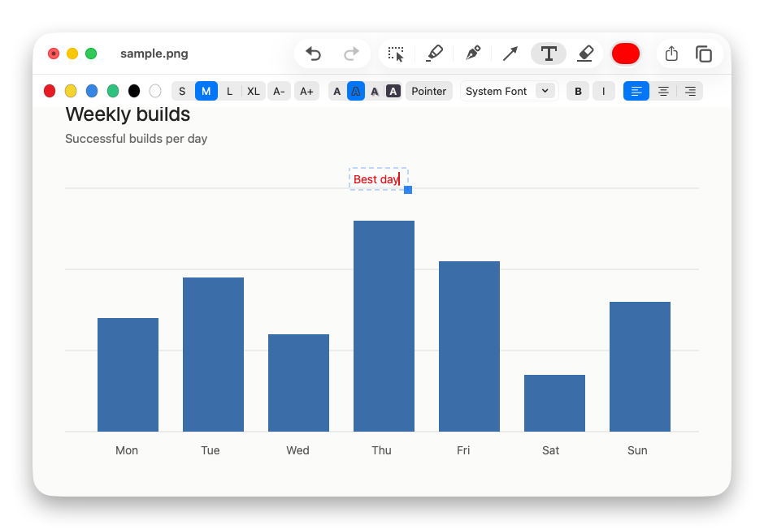
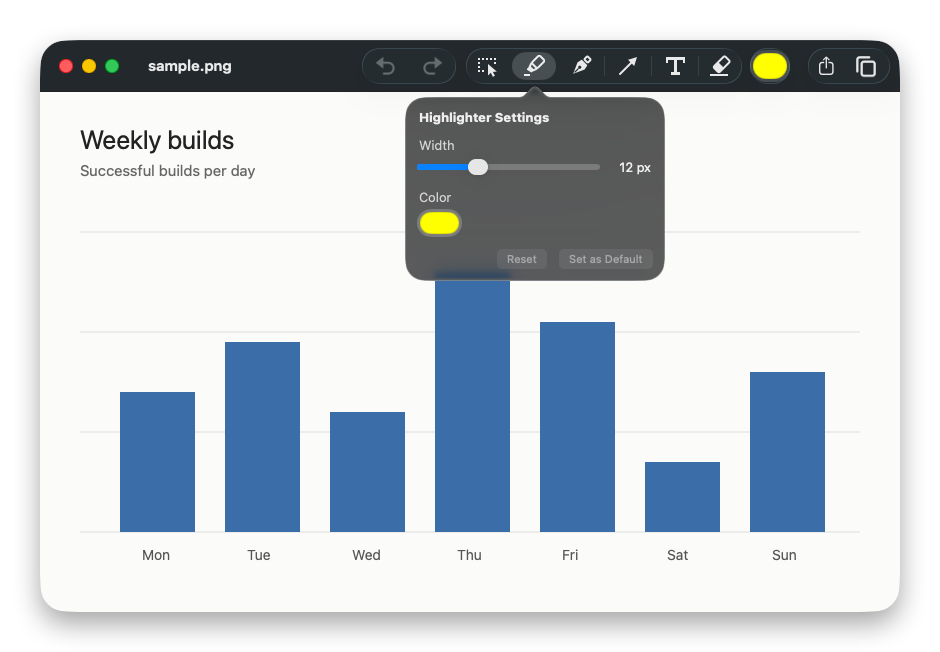
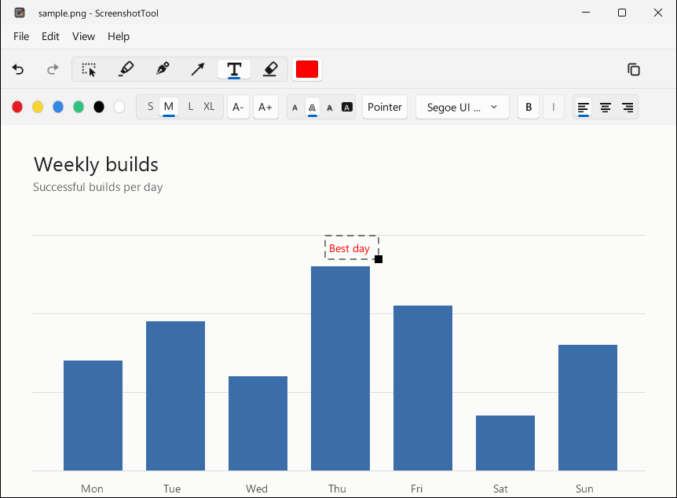
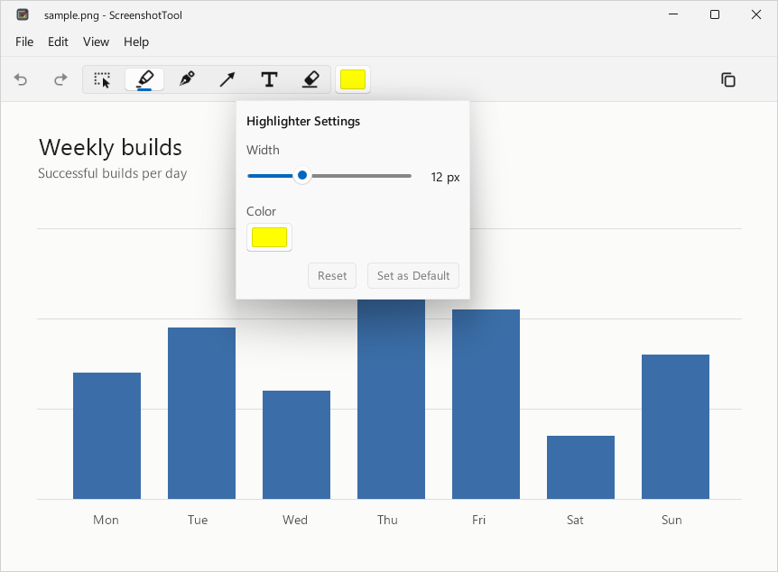
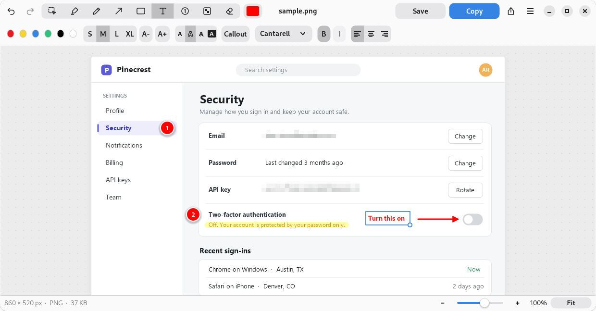
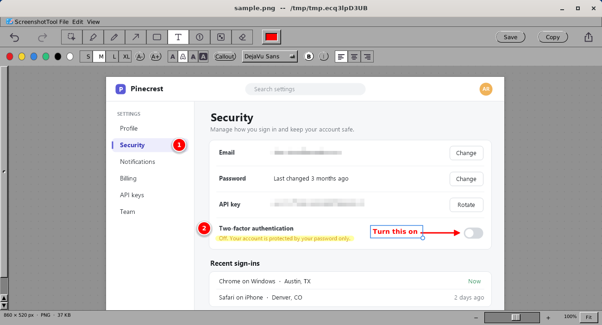
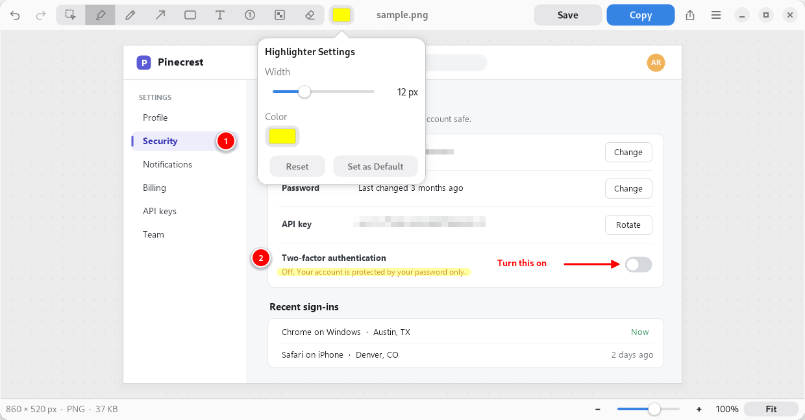

# ScreenshotTool

ScreenshotTool is a desktop screenshot annotation app for macOS, Windows and Linux. Open an
image or paste one from the clipboard, mark it up with pens, highlighters, arrows, text and
callouts, then copy the result, save it as an image, or save it as a project you can keep
editing.



It's free software (GPL v2 or later). On macOS it's a native AppKit app; on Windows, Linux and
the BSDs it's built with [GNUstep](https://gnustep.github.io/), and the GNUstep theme decides
how it looks.

## Download

Get the latest version from the
[Releases page](https://github.com/danjboyd/ScreenshotTool/releases/latest):

| Platform | Download | Requires |
|---|---|---|
| macOS | `ScreenshotTool-<version>-macOS.dmg` (Apple silicon and Intel) | macOS 12 or later |
| Windows | `ScreenshotTool-<version>-win64.msi`, or `ScreenshotTool-<version>-win64-portable.zip` to run without installing | 64-bit Windows 11 (Windows 10 1809 or later should work, but is untested) |
| Linux | `ScreenshotTool-<version>-x86_64.AppImage` | x86_64, glibc 2.38 or later (Ubuntu 24.04, Debian 13, Fedora 39 or later) |

`SHA256SUMS` on each release lists the files' checksums. Once installed, the app checks for
updates itself (**Check for Updates…**).

The release builds aren't signed with a paid developer certificate yet, so macOS and Windows
warn you the first time. The steps to get past that are below.

### macOS

Open the DMG and drag ScreenshotTool to Applications. The first time you open it, macOS says it
can't verify the app: click **Done**, then **Open Anyway** in System Settings → Privacy &
Security. Or, in Terminal:

```bash
xattr -dr com.apple.quarantine /Applications/ScreenshotTool.app
```

The DMG includes these steps as "Opening an unsigned app.txt".

### Windows

Run the MSI. It installs for your user only, in `%LOCALAPPDATA%\ScreenshotTool` (about 85 MB),
without asking for an administrator. There's no wizard, just a progress box; then
ScreenshotTool is in the Start menu (there's no desktop shortcut). Your browser may warn that the
file isn't commonly downloaded, and on a new Windows 11 PC, Smart App Control may block an
unsigned installer. To check the download, compare `Get-FileHash .\ScreenshotTool-<version>-win64.msi`
with `SHA256SUMS` (it prints the hash in capitals). Uninstall it from Settings → Apps →
Installed apps; your settings stay in `%USERPROFILE%\GNUstep\Defaults`.

Or unzip the portable build anywhere and run `ScreenshotTool.exe` from the unzipped folder.

If you installed v0.1.0 or a v0.1.1 release candidate before rc4, download and run the new MSI by hand
once: those versions' Check for Updates can't install updates on Windows. The MSI upgrades
the existing installation in place, and later updates install from inside the app.

Take Screenshot uses Windows' screen-snip overlay (the Snipping Tool, or Snip & Sketch on
Windows 10).

### Linux

Install the AppImage with a desktop entry and icon, and keep it updating:

```bash
curl -fsSL https://raw.githubusercontent.com/danjboyd/ScreenshotTool/main/scripts/install_appimage.sh | bash
```

That puts it in `~/Applications/ScreenshotTool.AppImage`. To remove it, run the same command
with `bash -s -- --uninstall` in place of `bash`; `--channel prerelease` installs release
candidates instead. The script needs `curl`, and `jq` or
`python3`. If you installed v0.1.0 or a v0.1.1 release candidate before rc4, run it again once: those
versions can't download updates themselves.

You can also download the AppImage, `chmod +x` it and run it directly. AppImages need FUSE's
`fusermount3` (the `fuse3` package, standard on desktop installs; `libfuse2` isn't needed), or
run it with `--appimage-extract-and-run`. Under GNOME it uses the bundled
[Adwaita theme](https://github.com/danjboyd/plugins-themes-Adwaita); elsewhere it uses
GNUstep's default theme, with the menus in the window. Shortcuts use Ctrl on every desktop.

## Features
- Pen, highlighter, arrow, rectangle, text, numbered step, redact, select and eraser tools; a
  selected rectangle or redaction resizes by its corner handles, steps number themselves 1, 2,
  3…, and a redaction pixelates the image under it (not the annotations over it). A project file
  keeps the original image so it stays editable, redactions included: share the saved image, not
  the project, when something must stay hidden. Pen, highlighter and
  text colours and widths are set from each tool's popover (double-click its
  toolbar button) and remembered as defaults.
- Text labels with a text bar for font, size, style and alignment; turn on
  Callout to make a label a callout: a filled box with bold text and a draggable pointer.
- Select, move and delete annotations; undo and redo every change from the
  toolbar or the Edit menu.
- Paste as New Image from the clipboard; Copy puts the annotated image (or the
  selection) on the clipboard with transparency intact.
- Share the annotated image (or the selection) from the toolbar, File > Share, the right-click
  menu or the bar next to a selection. macOS uses its own share menu. On Linux and Windows a
  sheet offers Email, Copy, Save a Copy, Show in Folder and Open With…, and, if
  [rclone](https://rclone.org) is installed, each of your remotes that can make links: the image
  is uploaded and its link copied.
- Save As writes a flattened PNG or TIFF. Save Project writes a `.screenshottool`
  file with the original image and editable annotations, which Open and Open
  Recent read back.
- Crop to Selection, Fit to Window, fixed zoom levels and Zoom In/Out.
- Drag the annotated image (or the selection) out of the Copy toolbar button into another app,
  a chat, a mail or a folder, as a PNG file named after the document (macOS and Linux).
- Custom actions: send the annotated image to a command of your own (an upload script, say)
  from the File menu, a toolbar button or the Share menus; see [Custom actions](#custom-actions).
- Standard controls throughout, so the GNUstep theme decides the look,
  including the toolbar, symbolic icons and the open and save dialogs.
- On macOS: a window per image (File > New Window, Open several at once); share
  the image from the toolbar or File > Share, drop images on a window to open
  them, and pinch or Command-scroll to zoom.

## Screenshots

### macOS

The native macOS app (adding text is shown at the top of this page). In dark mode, a tool's
width and colour, from its toolbar button:



To regenerate these, run `Tools/screenshots_macos.sh` after `scripts/build_cocoa.sh`; it saves
`macos-text.png` and `macos-dark-popover.png` in `build/screenshots-macos/`. The terminal needs
the Screen Recording permission.

### Windows

Under the [WinUI theme](https://github.com/danjboyd/plugins-themes-winuitheme), marking up a
settings page: numbered steps, a highlight, an arrow with a callout, and the email address and
API key redacted:



A tool's width and colour, from its colour button:



### Linux and BSD (GNUstep)

The app is built from standard controls, and the GNUstep theme decides how it looks. The same
window, marking up a settings page: numbered steps, a highlight, an arrow with a callout, and the
email address and API key redacted:



Under the [Adwaita theme](https://github.com/danjboyd/plugins-themes-Adwaita), as on a GNOME
desktop: the toolbar sits in the header bar, and the menus are in its ☰ menu, with no menu
bar row.



Under GNUstep's default theme, as on other desktops: the window manager's title bar, with the
menus in the window.



A tool's width and colour, from its colour button.

To regenerate these images, run `Tools/screenshots.sh` after building the app. It opens the app on a
private display under both themes, marks up the shared sample
(`Tools/screenshot-sample/security-settings.png`), and saves each screen whole and cropped to its
window (`*-window.png`; under Adwaita without the theme's shadow, with transparent rounded
corners). The images here are `adwaita-text-toolbar-window.png`, `default-text-toolbar-window.png`
and `adwaita-popover-window.png`. The default theme's needs the release build's GNUstep backend,
whose patch keeps the toolbar showing after the window resizes (#60): point `SCREENSHOT_APP` at a
script that runs the release AppImage's binary with its runtime.

## Building from source

### Linux / BSD (GNUstep)

Prerequisites: `gnustep-make`, `gnustep-base`, `gnustep-gui`, Clang, and
standard build tools.

```bash
git submodule update --init --recursive
make -j"$(nproc)"
```

Notes:
- Open and save dialogs come from the GNUstep theme: under the
  [Adwaita theme](https://github.com/danjboyd/plugins-themes-Adwaita) they're
  GNOME's own file chooser.
- A build from the tree uses the identifier `com.danboyd.screenshottool.dev`, so its settings
  (`~/GNUstep/Defaults/com.danboyd.screenshottool.dev.plist`) are apart from an installed
  release's. The release build passes `make ST_DEV_BUILD=no`.

### macOS (Cocoa-native)

```bash
scripts/build_cocoa.sh
scripts/smoke_macos_app.sh build/cocoa/ScreenshotTool.app
scripts/package_macos_dmg.sh build/cocoa/ScreenshotTool.app
```

Requires Xcode 26 or its Command Line Tools; GNUstep isn't needed. The build compiles the
sources and copies the resources `GNUmakefile` lists, and produces a universal app signed ad
hoc. Set `VERSION` to stamp a version, or `ARCHS=arm64` for a quicker one-architecture build.

Developer ID signing and notarization of the release DMG are planned (`macos.md`).

### Windows

The MSI is built with GNUstep under MSYS2 CLANG64; see `docs/Packaging.md`.

## Run

### Linux / BSD (GNUstep)

```bash
./ScreenshotTool.app/ScreenshotTool ~/Pictures/your-image.png
```

### macOS

Build `build/cocoa/ScreenshotTool.app` with `scripts/build_cocoa.sh`, then
`open build/cocoa/ScreenshotTool.app`. `scripts/smoke_macos_app.sh` launches it with a sample
image and fails if the image doesn't open.

Runtime logs default to `~/.local/state/screenshottool/screenshottool.log` on
GNUstep/Linux and `~/Library/Logs/ScreenshotTool/screenshottool.log` on macOS.
Set `SCREENSHOT_TOOL_LOG_PATH=/tmp/screenshottool.log` to override the log
location.

## Testing

Run the automated probes with:

```bash
make                 # the test bundle links libraries the app build produces
Tools/run_tests.sh
```

Run one class or test by name, or pass any `xctest` option (tests use the
[tools-xctest](https://github.com/danjboyd/tools-xctest) submodule; run
`git submodule update --init` after cloning):

```bash
Tools/run_tests.sh FitViewportRoundingProbeTests
Tools/run_tests.sh FitViewportRoundingProbeTests/testFitTurnsOffAutohidingScrollers
Tools/run_tests.sh -test-iterations 20 TitleBarToolbarProbeTests
```

Results go to `tests.log` and, as JUnit XML, `tests-junit.xml`.

Most tests need a window server. Without a desktop session (as in CI), run them
under a virtual display with `xvfb-run -a Tools/run_tests.sh`; the script fails
if tests had to skip for lack of a display.

On macOS, `Tools/run_tests_macos.sh` builds the same tests against Apple's XCTest
(it needs Xcode) and runs them, optionally just the classes or tests you name.
The log goes to `tests-macos.log`.

### Screenshots

`Tools/screenshots.sh` captures the main screens (empty window, Preferences,
an image, the text bar, the tool popover) under GNUstep's default theme and
Adwaita on a private virtual display, into `screenshots/`. It needs Xvfb,
xdotool, x11-utils and ImageMagick, plus GNOME Shell or Openbox for window
decorations. Your GNUstep defaults are left untouched. CI uploads the images
as the `screenshots` artifact.

### Closing windows under GNOME

`Tools/check_wm_close.sh ScreenshotTool-x86_64.AppImage` runs the AppImage as GNOME would, with
the Adwaita theme, under GNOME Shell or Mutter on a private virtual display. It checks that
the windows list `WM_DELETE_WINDOW`, and that asking the window manager to close Preferences,
then the main window (as Alt+F4 or the Overview does), closes them without the app being
killed. It needs Xvfb, xdotool, x11-utils, wmctrl and `dbus-run-session`. Your GNUstep
defaults are left untouched. CI runs it on each AppImage.

## Usage Tips
- Double-click a tool's toolbar button to open its popover.
- Right-click the image for what fits where you clicked: in a selection, Crop, Copy or Redact it;
  on an annotation (which it selects), Edit Text, Duplicate, Bring to Front, Send to Back or
  Delete; elsewhere, Copy Image, Paste as New Image, zooming, Save As and your custom actions.
  `Esc` clears the selection.
- A finished selection gets a small bar next to it with Crop, Copy and Redact; Preferences >
  Appearance turns it off.
- Preferences hold the drawing and text defaults, the default save folder
  and whether the status bar is shown.
- While editing text, `Ctrl+Return` or `Esc` finishes the label and `Return`
  starts a new line.
- Save As flattens the annotations into the image; use Save Project to keep
  them editable.

### Keyboard Shortcuts (GNUstep)
- Open: `Ctrl+O`
- Save As: `Ctrl+S`; Save Project: `Ctrl+Shift+S`
- Undo / Redo: `Ctrl+Z` / `Ctrl+Shift+Z`
- Copy: `Ctrl+C`; Paste as New Image: `Ctrl+Shift+V`
- Crop to Selection: `Ctrl+K`
- Fit to Window: `Ctrl+0`; 100%: `Ctrl+1`
- Zoom In / Out: `Ctrl+=` / `Ctrl+-`
- Preferences: `Ctrl+,`

## Custom actions
A custom action hands the annotated image (or the selection, when there is one, as Copy does)
as a PNG to a command of your own and copies what it prints, so a personal workflow is one
click. The app ships none: each is a JSON file in your actions folder, read at launch.

| Platform | Folder |
|---|---|
| Linux / BSD | `~/.config/screenshottool/actions/` (under `$XDG_CONFIG_HOME`) |
| Windows | `%APPDATA%\ScreenshotTool\Actions\` |
| macOS | `~/Library/Application Support/ScreenshotTool/Actions/` |

`$SCREENSHOT_TOOL_ACTIONS_DIR` overrides the folder.

```json
{ "title": "Send to Server",
  "command": ["/usr/local/bin/upload", "--file", "{file}", "--host", "{choice}"],
  "choices": ["/usr/local/bin/upload", "--list-hosts"],
  "output": "clipboard",
  "toolbar": true,
  "icon": "send.png" }
```

- `title` (required): the name in the File menu and on the toolbar.
- `command` (required): the program, found on `PATH` or given as a path, and its arguments.
  `{file}` becomes the PNG's path and `{choice}` the choice picked.
- `choices`: a command whose output lines are the choices, listed in a submenu (and the toolbar
  button's arrow). The first is the default, which the button itself runs.
- `output`: `clipboard` (the default) copies what the command prints and says so; `none` ignores it.
- `toolbar`: `true` adds a toolbar button. `icon` is an image file for it, relative to the actions
  folder or absolute. Under GNOME's header bar an action with an icon is an icon button, which
  leaves room for the window's title.
- `timeout`: seconds before the command is stopped (120 by default).

The command runs in the background, and the action is disabled while it runs or when no image is
open. If it fails, an alert shows the last line of its error output. The PNG and its folder are
removed when the command exits, so a command that hands the file to a process it leaves running
must copy it first. A file that isn't a valid action is skipped, and the log says why. From the
AppImage, commands get your own environment, without the AppImage's library paths.

## Project Docs
- Contributing and development notes: `CONTRIBUTING.md`
- Workflow and testing handoff: `WORKFLOW.md`
- Packaging and releases: `docs/Packaging.md`
- Bugs, feature requests and planned work: [GitHub Issues](https://github.com/danjboyd/ScreenshotTool/issues)

## License

GNU GPL v2 or later. See `COPYING`.
